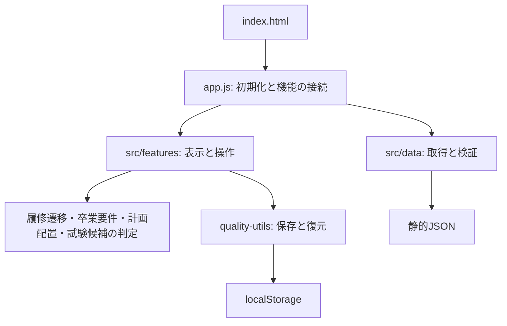

# 設計と変更方針

## 責務と依存方向

`app.js`は状態、保存先、機能間のコールバックを組み立てるcomposition rootです。コントローラー同士が暗黙のグローバル関数を呼ばず、必要な値・処理を`create(context)`で受け取ります。各モジュールが公開するのは呼び出し元が必要とする関数だけです。

コントローラーの生成とイベントの登録を分けています。`create`では関数と画面内状態を定義し、起動処理が全コントローラーを接続してから`setup`や描画を呼びます。後で定義されるコールバックはgetterで渡し、初期化時の未定義参照を避けます。これはDOMを遅延生成する画面や相互更新のための制約であり、getterの呼び出しをコンストラクター内へ移してはいけません。

ブラウザ向けに公開する小さな名前空間と、Nodeテスト用のCommonJSエクスポートを提供します。実行時のモジュールローダーやUIフレームワークを追加せず、静的配信と既存データを維持しています。

## 機能の内部構成

- 4年計画はコントローラー、ダイアログ／フォーカス、卒業要件パネルに分けています。
- 埋め込みマップはコントローラー、レイアウト計算、入力操作に分けています。
- 独立マップの座標・カメラ計算は`src/features/map/geometry.js`へ分離しています。既存の`curriculum-map.js`のNode APIは維持します。
- データリポジトリは通信と検証エンジンを注入し、DOMなしで障害や不正データの動作をテストします。
- ローカルサーバーとブラウザセッションはQA間で共有し、コード・プロファイル管理・配信ポリシーの重複を防ぎます。

## 状態と保存の契約

状態は起動処理が所有し、UIは同じ状態を参照します。履修予定・履修済みの排他性は`src/domain/enrollment-state.js`が新しいSetを返す純粋な遷移として表します。画面からのアクションは履修コントローラーで保存し、成功してから共有状態と画面を更新します。

| キー                               | 保存形式                              | 所有する機能   |
| ---------------------------------- | ------------------------------------- | -------------- |
| `myClasses`                        | 科目IDの配列                          | 履修予定       |
| `completedClasses`                 | 科目IDの配列                          | 履修済み       |
| `zenCourseHubStorageSchemaVersion` | 既存スキーマのバージョン              | 保存の安全確認 |
| `fourYearSimulatorPlanV1`          | version・placementsを持つオブジェクト | 4年計画        |
| `courseFilterPreferences`          | 探索条件の既存オブジェクト            | 科目探索       |

保存前の値を記録し、途中で例外や読戻し不一致が発生した場合は復元します。復元失敗を通常の保存失敗と区別し、以後の上書きを停止します。未知IDは削除せず保持します。UIの都合でマイ履修と4年計画のキーを統合してはいけません。

## データ読込と障害の範囲

科目カタログは必須です。難易度・参考関係・卒業要件定義・試験日程は個別に取得し、用途に応じて非表示や判定停止へ切り替えます。試験日程の応答を待つために科目探索全体を停止させません。データ取得はリポジトリ層、用途別の復旧方針は各ローダー、画面への反映順は起動処理が担当します。

フィードバックのURLは信頼せず、科目IDをカタログで確認してから名前を補完します。フォームは明示的に入力された項目のみPOSTし、保存された履修情報にはアクセスしません。サービスの受付をクライアントだけで成功と決めつけません。

## CSSと公開ビルド

`src/styles/`のファイル順は`scripts/styles.cjs`で明示します。既存UIのカスケードを保つため、基底・機能・レスポンシブ・互換性上書きの順を維持しています。同じ条件・セレクター・プロパティ・値・優先度の完全重複で、後から必ず上書きされる宣言を除去しました。異なる値のフォールバックを一律削除する最適化は行いません。

ビルドはPostCSSで構文を検証し、1ファイルの`style.css`を生成します。生成物は既存の静的URLとの互換性のためGitにも保持し、CIで編集元と一致することを確認します。

公開用ビルドは明示したファイルのみを出力します。ネストした機能モジュールも許可リストで指定し、相対パスの逸脱・隠しファイル・シンボリックリンクを拒否します。出力先に想定外のファイルがある場合は削除せず停止します。`netlify-dist/`を手作業のファイル置き場にしてはいけません。

## テストの層

- 純粋な判定: 卒業要件、配置、履修遷移、試験候補の並べ替え・重複検出。
- 機能の契約: 部分保存失敗と復元、機能別の取得失敗、未知IDの保持、任意データが未応答でも開始できる起動処理。
- 配信の契約: 公開ファイル、相対パスの安全性、生成CSS、開発サーバーの許可リストとHTTPメソッド。
- 実ブラウザ: 専用プロファイルで1280px・390px等を操作し、マップ・履修・卒業要件・4年計画・試験・報告フォームを検証。

既存の画面構造を確認するソース契約テストは、分離された全モジュールを対象にしています。整形の空白には依存させません。重要な保存・障害の契約にはコントローラーを直接呼ぶ動作テストを追加しています。

判定・保存処理に対するカバレッジは`npm run test:coverage`で確認できます。行90%・分岐80%・関数95%を最低条件にしています。DOMコントローラーのカバレッジを含む数値ではなく、UIは別の実ブラウザQAで確認します。

## 今後の変更で守ること

1. カタログIDとlocalStorageのキー・スキーマをUI変更のついでに変えない。
2. 業務判定をDOMイベントやHTML文字列へ埋め込まない。
3. 初期化時に別コントローラーを呼び出さず、接続完了後に実行する。
4. 元データ・生成データ・公開データの境界を維持する。
5. CSSの生成物を直接編集しない。カスケードを変える場合は両画面幅でQAする。
6. ローカルのフォーム応答を実受信の証拠にしない。本番設定は別途確認する。
